<p align="center">
  <picture>
    <source media="(prefers-color-scheme: dark)" srcset="src/Clients/Blinkr.Expo/assets/brand/mark-dark.svg">
    
  </picture>
</p>

<h1 align="center">Blinkr</h1>

<p align="center">
  <b>See what is happening at a place right now — and how much you can trust it.</b><br>
  A map-first mobile app for live place signals, built on an event-sourced .NET microservice backend.
</p>

<p align="center">
  
  
  
  
  
  
  
  
</p>

<p align="center">
  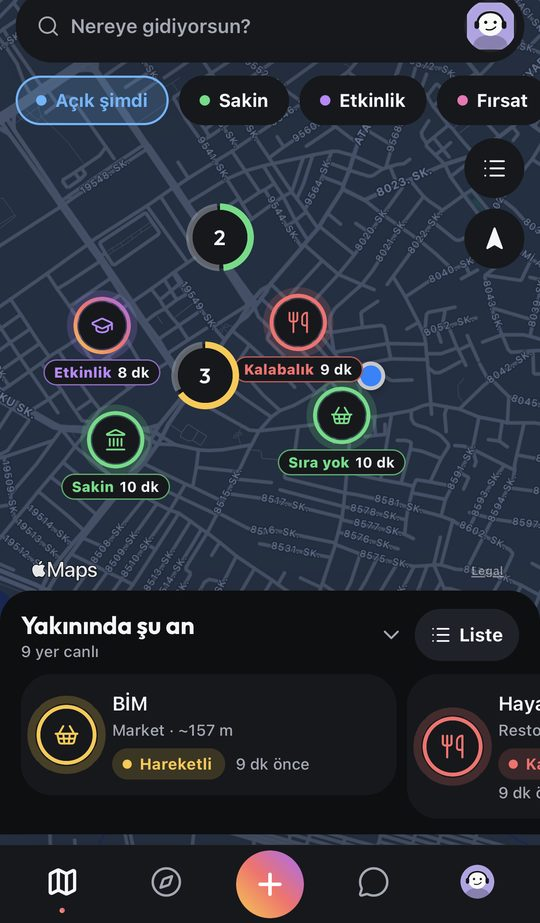
  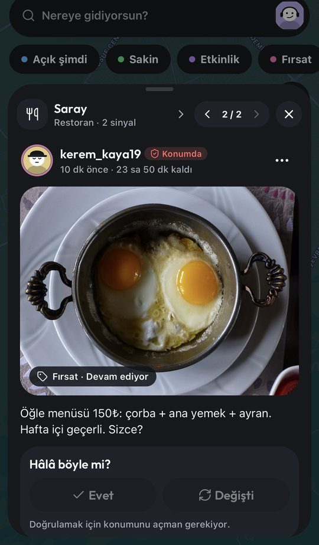
  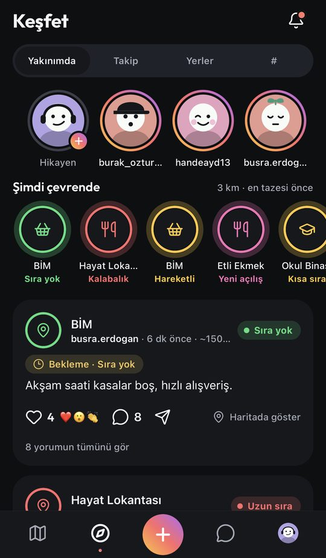
  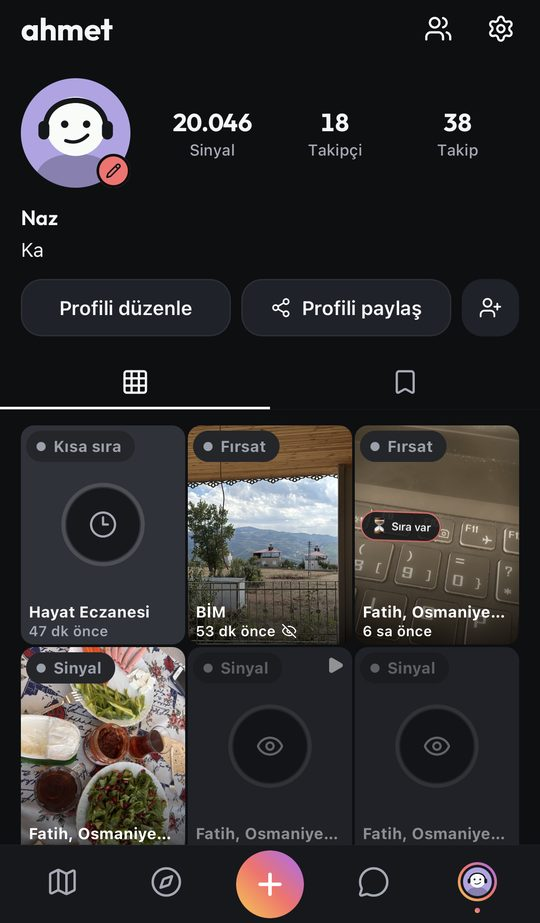
</p>

<details>
<summary><b>🇹🇷 Türkçe özet</b></summary>

**Blinkr**, insanların gerçek dünyada bir yer hakkında daha hızlı, doğru ve güvenli karar vermesini sağlayan **harita merkezli** bir mobil uygulamadır. "Bu kafede masa var mı?", "Markette sıra ne durumda?", "Bu mahallede şu an etkinlik var mı?" gibi soruların cevabı, kullanıcıların yerinde paylaştığı kısa ömürlü **sinyallerle** haritada görünür. Her yer, durumunu (açık, sakin, kalabalık, sıra var…) ve bilginin **ne kadar taze** olduğunu gösteren bir **Canlı Halka** ile çizilir.

Uygulama; Keşfet akışı, hikâyeler, takip sistemi, tepki ve yorumlar, mesajlaşma ve tek seferlik "snap"ler, koleksiyonlar, "Haber ver" yer izlemeleri ve "Hâlâ böyle mi?" ile bilgiyi yeniden doğrulama gibi bir sosyal katman da içerir — ama her içerik hâlâ bir **yere** bağlıdır ve süreli yaşar.

Arka planda **event sourcing + CQRS** kullanan, **YARP API Gateway** arkasında çalışan çok servisli bir **.NET 10** backend bulunur: yazma tarafı EventStoreDB, olay dağıtımı RabbitMQ, okuma modeli MongoDB'dir; gerçek zamanlı güncellemeler SignalR ile gelir. Bir sinyalin güvenilirliği istemcinin beyanına değil, **sunucunun hesapladığı mesafe ve konum doğruluğuna** göre belirlenir. Mobil istemci **React Native + Expo (SDK 57)** ile yazılmıştır, Türkçe ve İngilizce arayüz ile koyu/açık tema destekler.

</details>

---

## ✨ What is Blinkr?

Map apps tell you where a place is and show static details. Social feeds produce a lot of content with very little context. Blinkr sits in between: people publish short-lived **signals** about a real place — crowd level, queue length, a temporary closure, an offer, an event, a new opening — and everyone else sees them on the map, together with how **fresh** and how **trustworthy** each one is.

**Principles that shape the code**

- **Map-first, place-first.** The home screen is the map, and content belongs to a `Place` or an approximate area. The social features (feed, stories, follows, chat) are built *around* places, not instead of them.
- **Trust is server-owned.** Distance and publication trust are computed by the backend on every publish; client-supplied flags never authorize anything.
- **Privacy by default.** Precise device coordinates are never shown publicly, anonymous posts never leak the author, and photo metadata (EXIF, including location) is stripped before storage.
- **Freshness over volume.** Everything expires. A ring around each place drains as its information ages, so stale data never looks new.
- **Reliability is product value.** A lost event or a late projection can cause a wrong decision, so the pipeline is built for at-least-once delivery with idempotent consumers.

> **Status:** working product in active development. The latest app (screenshots below) lives on the development branch `feat/blinkr-v4-device-fixes`; the automated acceptance suite passed on 2026-09-13 and two-physical-device native acceptance is still pending. See the [roadmap](#-roadmap--known-limits).

## 📱 App tour

### The Live Ring map

Every place is drawn the same way everywhere in the app: the **color is the state** (open, calm, busy, event, offer…), the **arc is freshness** (full for 15 minutes, empty after 3 hours), the **icon is the kind of place**, and a short label says what is going on and how long ago. Filter chips such as *Açık şimdi · Sakin · Etkinlik · Fırsat* narrow the map to what you need, and a "Yakınında şu an" sheet lists the live places around you.

<table>
  <tr>
    <td align="center" width="33%"><br><sub><b>Live rings</b> with status chips</sub></td>
    <td align="center" width="33%">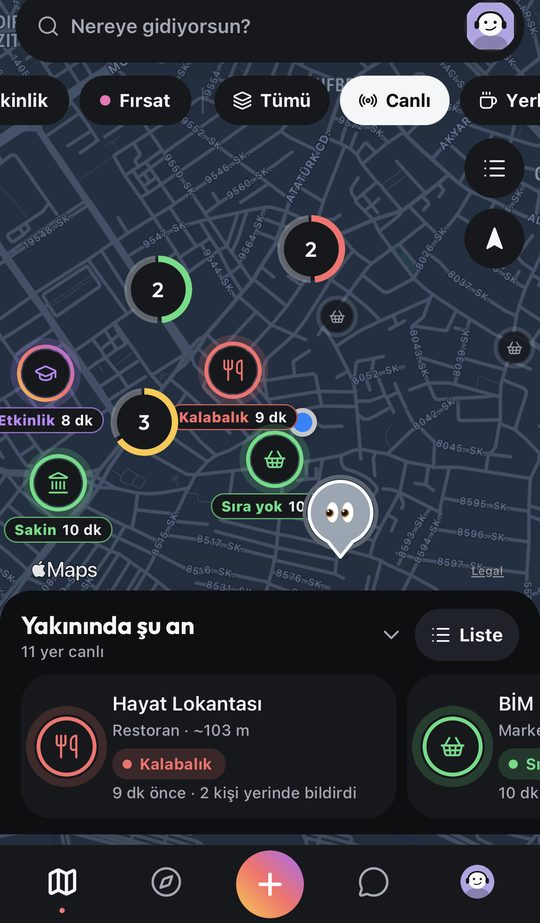<br><sub><b>Live</b> layer: verified, fresh places</sub></td>
    <td align="center" width="33%">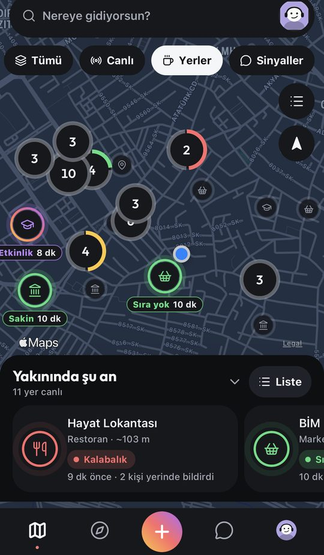<br><sub><b>Places</b> layer: the local catalog</sub></td>
  </tr>
  <tr>
    <td align="center">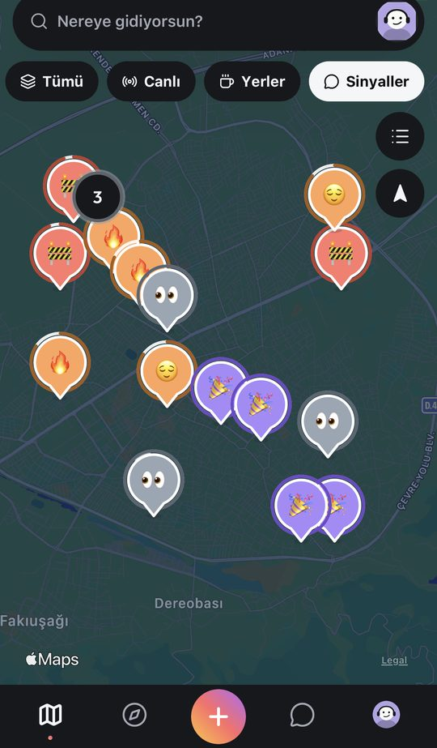<br><sub><b>Signals</b> layer: area signals not tied to a place</sub></td>
    <td align="center"><br><sub><b>Place card</b> with a "Still like this?" check</sub></td>
    <td align="center">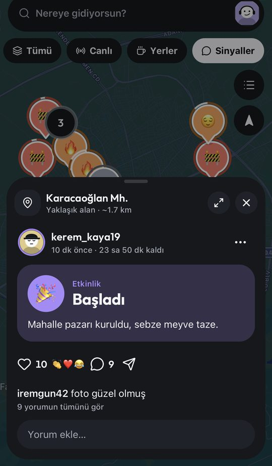<br><sub><b>Area signal</b> on an approximate location</sub></td>
  </tr>
</table>

### Sharing, Discover and social

Tap **+** to publish a quick signal in a few seconds: the place is found from your location, you pick one of eight signal types, and the server decides whether your distance makes the post *verified live*. Hold **+** to open the in-app camera. Around that core, Blinkr has a Discover feed, stories, follows, reactions and comments — all still anchored to places.

<table>
  <tr>
    <td align="center" width="33%">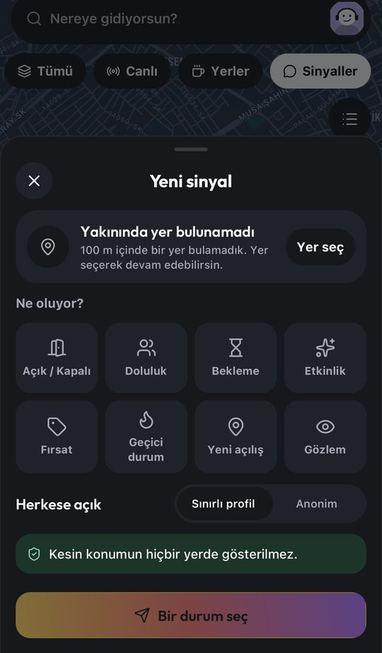<br><sub><b>Quick signal</b>: eight types, one tap</sub></td>
    <td align="center" width="33%"><br><sub><b>Discover</b> with stories and "Right around you"</sub></td>
    <td align="center" width="33%">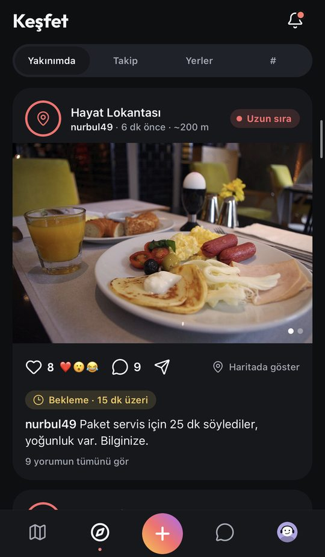<br><sub><b>Nearby</b> feed ranked by freshness</sub></td>
  </tr>
  <tr>
    <td align="center">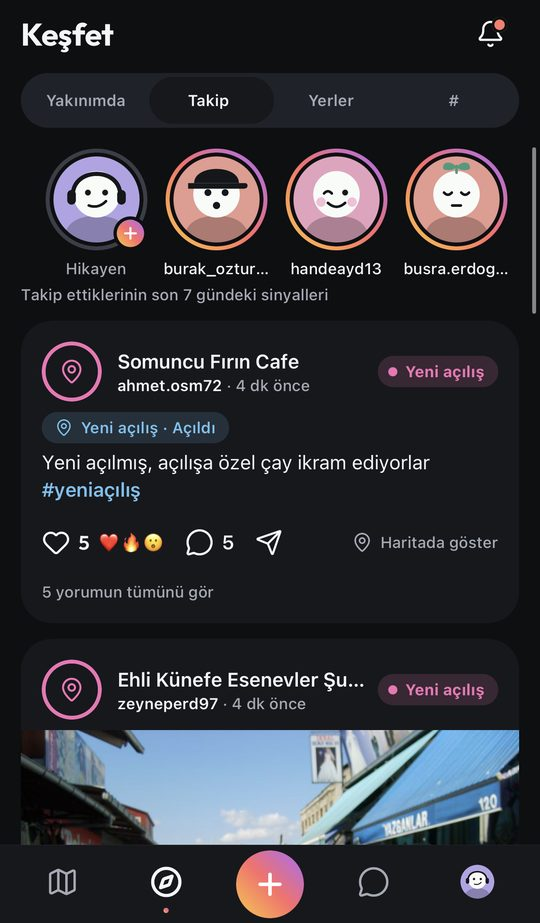<br><sub><b>Following</b> feed with hashtags</sub></td>
    <td align="center"><br><sub><b>Comments</b>, reactions and re-verification</sub></td>
    <td align="center"><br><sub><b>Profile</b> with a signal grid</sub></td>
  </tr>
</table>

## ✅ Features

**Map and places**
- Four map layers — all activity, live places, catalog places, area signals — with clustering and a dark map style.
- **Live Ring** status system with filter chips and a "right around you" sheet.
- Local catalog of about **34.7K OpenStreetMap places** (idempotent importer with category normalization), so discovery stays fast and doesn't depend on a public provider being up.
- "Where to?" place search with category shortcuts, recent searches and Turkish-insensitive matching.
- **Place rhythm** (typical busy hours by weekday), **place attributes** (crowd-voted yes / no / mixed facts with last-confirmed age), and **"Ask the place"** questions that nearby people can answer.
- **"Haber ver"** place watches: get notified when a place becomes calm, opens, or gets an update.
- Saved places with live status, and collections.

**Signals**
- Eight signal types: open/closed, crowd, queue, temporary status, offer, event, new opening, observation.
- **"Still like this?"** one-tap re-verification of an existing signal (only possible when you're actually there).
- In-app camera with live lenses, a photo editor, and an offline-tolerant **outbox**: posts are uploaded in the background and wait on the device when there's no connection.

**Social layer**
- **Discover** feed: Nearby, Following, Places and `#hashtag` tabs.
- **Stories** (24 hours, visible to the author and approved followers, no location).
- **Follows** with public and private accounts, plus mutual friends.
- Reactions (❤️ or six emoji), threaded comments, `@mentions` and `#hashtags`.
- **1:1 chat** with view-once **snaps**, shared signals and shared places, typing indicators and read state.
- **Real-time** updates through a SignalR hub, falling back to light polling when disconnected.

**Safety and account**
- Block (two-way, silent), report and admin moderation actions on reports.
- Rate limits, an age gate, privacy for accounts, data-request and account-deletion flows.
- Turkish and English UI, light and dark themes, deep links such as `blinkr://posts/{id}`.

## 🔄 The core loop

Everything in the architecture exists to make this chain reliable:

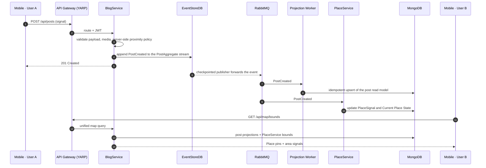

## 🏗️ Architecture

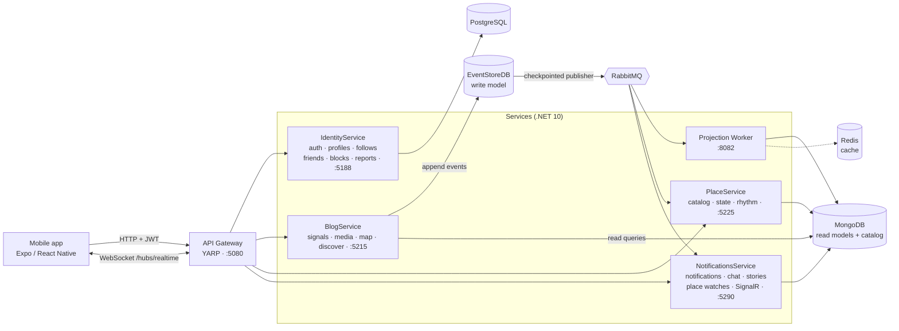

**How the pieces fit**

- **Write side (event sourcing):** `PostAggregate` emits domain events that are appended to EventStoreDB — the only authoritative write store.
- **Event delivery:** a publisher reads EventStoreDB from a persisted checkpoint and forwards events to RabbitMQ. The checkpoint only moves after a successful publish, which gives **at-least-once** delivery.
- **Read side (CQRS):** the projection worker consumes events and updates MongoDB read models with **idempotent** upserts and an inbox of processed message IDs. Redis is a cache, never a source of truth.
- **Place context:** PlaceService owns the local OSM catalog, the per-place signal projection, and the computed *Current Place State* (freshness and confidence) that drives the Live Ring. The app derives a ring from that server summary — it never computes a second opinion.
- **Gateway:** the mobile app talks only to the YARP gateway, never directly to a service. The real-time hub is exposed through it too.
- **Real-time events carry only identity** ("something changed"); the app then refreshes through REST, so anonymity, block and privacy rules live in exactly one place.

### Trust model

A user can *see* a place from far away, but publishing and influencing live state require being close. The backend recomputes this on every publish:

| Distance to the place | Result |
|---|---|
| ≤ 200 m | `VERIFIED_LIVE` — can update the live state of the place |
| 200 – 600 m | `NEARBY_PLACE_POST` — published as place content, excluded from live aggregation |
| > 600 m | Publishing to the place is rejected |
| up to 1.5 km | Place is still discoverable and selectable, but this does not authorize publishing |

Effective distance is `max(0, distance − min(accuracy, 50 m))`, device accuracy worse than 150 m is rejected, and places with polygon geometry (parks, large venues) are measured against their boundary instead of a centroid.

## 🧰 Tech stack

| Layer | Technologies |
|---|---|
| **Backend** | C#, .NET 10, ASP.NET Core, MediatR (CQRS), YARP reverse proxy, MassTransit, SignalR, JWT authentication |
| **Messaging & data** | EventStoreDB (event sourcing), RabbitMQ, MongoDB (read models + place catalog), PostgreSQL (identity), Redis (cache), NetTopologySuite (geometry) |
| **Mobile** | React Native 0.86, Expo SDK 57, React 19, TypeScript, react-native-maps, supercluster (clustering), expo-camera, expo-location, expo-video, expo-secure-store, Reanimated |
| **Tooling** | OpenStreetMap PBF place importer, Docker Compose, PowerShell dev scripts |

## 🔌 API surface (through the Gateway)

| Route | Service | Purpose |
|---|---|---|
| `/api/auth/*`, `/api/users/*` | IdentityService | Register, login, refresh, profiles, user search, saved places |
| `/api/follows/*`, `/api/friends/*` | IdentityService | Follow / private-account requests, friend requests |
| `/api/blocks/*`, `/api/reports/*`, `/api/admin/*` | IdentityService | Blocking, reporting, moderation actions |
| `/api/collections/*` | IdentityService | Place collections |
| `/api/posts/*`, `/api/posts-read/*` | BlogService | Create and read signals, comments, reactions |
| `/api/map/*` | BlogService | Unified map bounds and nearby (places + area signals) |
| `/api/discover/*` | BlogService | Nearby, following and hashtag feeds |
| `/api/v1/media/*` | BlogService | Presign, upload, and read media |
| `/api/places/*` | PlaceService | Nearby, search, bounds, detail, rhythm, attributes, questions |
| `/api/notifications/*`, `/api/subscriptions/*`, `/api/place-watches/*` | NotificationsService | Notifications, subscriptions, "Haber ver" watches |
| `/api/chat/*`, `/api/stories/*` | NotificationsService | 1:1 chat, snaps, stories |
| `/hubs/realtime` | NotificationsService | SignalR real-time channel |

## 📂 Project structure

```text
.
├── src/
│   ├── Gateway/ApiGateway                     # YARP gateway — single entry point for the mobile app
│   ├── Services/
│   │   ├── IdentityService                    # canonical JWT authority, profiles, follows, blocks, reports
│   │   ├── BlogService                        # event-sourced posts and signals, media, map and discover feeds
│   │   ├── PlaceService                       # place catalog, place signals, current place state
│   │   ├── NotificationsService               # notifications, chat and snaps, stories, place watches, SignalR
│   │   ├── WorkerService/Blinkr.Projections.Worker   # RabbitMQ → MongoDB projections
│   │   ├── MonitoringService                  # health and monitoring (work in progress)
│   │   └── IdentityServerService              # IdentityServer experiment, not the canonical authority
│   ├── BuildingBlocks/                        # Shared (auth contracts) and Shared.Events (integration events)
│   ├── Clients/Blinkr.Expo                    # React Native + Expo mobile app
│   └── Tools/                                 # OSM place importer, author-name migrator
├── tests/                                     # real-catalog publication checks, content filter tests
├── scripts/                                   # dev stack start/stop/status and acceptance scripts (PowerShell)
├── docs/                                      # architecture notes, validation report, product charter, plans
└── docker-compose.yml                         # PostgreSQL, Redis, EventStoreDB, RabbitMQ, MongoDB, worker
```

## 🏁 Getting started

The dev tooling is PowerShell-based, so the quickest path is **Windows**.

**Prerequisites:** Docker Desktop (Linux containers), the [.NET 10 SDK](https://dotnet.microsoft.com/download), [Node.js](https://nodejs.org/) 22.13 or newer, and a phone with Expo Go or a development build on the same Wi-Fi network as your computer.

### 1. Configure

Docker Compose reads its credentials from a root-level `.env` file. Use your own local values for these variables and never commit real secrets:

```text
POSTGRES_USER / POSTGRES_PASSWORD / POSTGRES_DB
PGADMIN_DEFAULT_EMAIL / PGADMIN_DEFAULT_PASSWORD
RABBITMQ_DEFAULT_USER / RABBITMQ_DEFAULT_PASS
MONGO_INITDB_ROOT_USERNAME / MONGO_INITDB_ROOT_PASSWORD
MONGO_EXPRESS_LOGIN / MONGO_EXPRESS_PASSWORD
```

### 2. Start the backend

From the repository root:

```powershell
powershell -ExecutionPolicy Bypass -File .\scripts\start-blinkr-dev.ps1
```

This starts the Docker infrastructure and the Identity, Blog, Place and Notifications services plus the Gateway, then runs health checks. Check or stop it later with `status-blinkr-dev.ps1` and `stop-blinkr-dev.ps1` (add `-Infrastructure` to stop Docker too).

| Component | Port |
|---|---|
| Gateway | 5080 |
| IdentityService | 5188 |
| BlogService | 5215 |
| PlaceService | 5225 |
| NotificationsService | 5290 |
| Projection Worker | 8082 |
| EventStoreDB / RabbitMQ UI / Mongo Express | 2113 / 15672 / 8081 |

### 3. Load the place catalog (optional but recommended)

Download a regional OpenStreetMap extract (for example Turkey from Geofabrik), keep it outside git, and import it. The importer is idempotent, so re-running it does not create duplicates.

```powershell
powershell -ExecutionPolicy Bypass -File .\scripts\bootstrap-place-catalog.ps1 -PbfPath C:\osm\turkey-latest.osm.pbf
```

Without a catalog the app still works with area signals, and the API reports the gap with an `X-Blinkr-Place-Coverage: not_loaded` header.

### 4. Run the mobile app

```powershell
cd src\Clients\Blinkr.Expo
npm install
npm run start:lan
```

The launcher detects your LAN IP, points the app at the Gateway (`EXPO_PUBLIC_BLINKR_API_URL=http://<your-ip>:5080`), and prints a QR code for your phone. Remember that `localhost` on a phone is the phone itself.

### 5. Run the tests

```powershell
dotnet build Blinkr.sln

# mobile (from src\Clients\Blinkr.Expo)
npm run typecheck
npm run lint
npm run test:nearby
npm run test:live
npm run test:product
npm run test:theme
npm run test:i18n
npm run test:ui

# backend acceptance (with the stack running)
powershell -ExecutionPolicy Bypass -File .\scripts\test-product-08.ps1
```

More targeted scripts (auth smoke, reliable event delivery, nearby contract, live signal, media, catalog coverage) are in [`scripts/`](scripts).

## 📈 Validation

From the validation report generated on 2026-09-13 ([`docs/BLK-PRODUCT-08.md`](docs/BLK-PRODUCT-08.md)):

- 12 policy and aggregation checks passed, covering 100 m, 350 m and 900 m publications, bounded accuracy, polygon interior, polygon holes, boundary fallback, and legacy-event fail-closed behavior.
- Real-catalog checks through the Gateway passed, including a large polygon boundary more than 500 m from its centroid and distinct same-name branches.
- A spoofed client trust flag could not authorize a 900 m publication.
- Gateway, auth, nearby-distance, live-signal and media smoke scripts passed; Expo typecheck, mobile logic tests and browser component tests passed; iOS and Android Expo exports succeeded.

The mobile client also has 40+ logic test files (feeds, stories, follows, chat, safety, realtime policy, theme contrast, i18n key parity), run through the npm scripts above.

## 🗺️ Roadmap & known limits

Next steps, in priority order:

1. Finish two-physical-device acceptance for GPS, iOS touch behavior, camera and video playback.
2. Complete Turkey-wide catalog coverage and add a coverage metric.
3. Harden event delivery with failure injection, reconciliation between EventStoreDB and MongoDB, and visible dead-letter handling.
4. Security hardening: TLS, CORS, secret management, refresh-token rotation, and dependency audit cleanup.
5. CI quality gates and signed native builds.
6. Production observability, backups and a data-retention policy.

Known limits today: GPS is device-reported (the server owns the distance math but cannot prove hardware coordinates are genuine), the local stack is a single-node Docker Compose setup rather than a highly available deployment, and complex OSM relations fall back to point geometry.

## 📚 Docs

- [`docs/architecture-cqrs-es.md`](docs/architecture-cqrs-es.md) — CQRS and event-sourcing design notes
- [`docs/BLK-PRODUCT-08.md`](docs/BLK-PRODUCT-08.md) — implementation and validation report
- [`docs/Product_Constitution_Blinkr_Urun_Anayasasi.docx`](docs/Product_Constitution_Blinkr_Urun_Anayasasi.docx) — product charter (Turkish)
- [`scripts/README.md`](scripts/README.md) — dev scripts and catalog import
- [`src/Clients/Blinkr.Expo/README.md`](src/Clients/Blinkr.Expo/README.md) — mobile client guide (Turkish)

## 👤 Author

**Halil İbrahim Yıldırım** — .NET backend developer

[GitHub](https://github.com/devlightening) · [LinkedIn](https://www.linkedin.com/in/0001myprofile) · [Portfolio](https://portfol-io-xi.vercel.app) · ce.hybusiness@gmail.com
